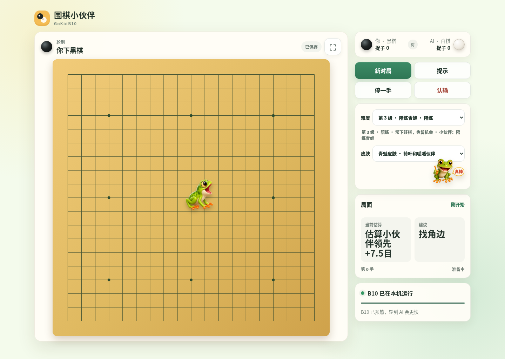

# GoKidCoachWeb｜会动的青蛙儿童围棋陪练

GoKidB10 是面向约 6 岁儿童的 19 路围棋陪练网页。默认的**青蛙皮肤**会在吃子时做出咬石、吞石、跳动与音效反馈：每颗被提走的棋子都会先摇晃，再被小青蛙一口吃掉，让真实围棋规则变成孩子看得见、听得见的奖励。

它只使用经过实体 iPad Safari 验证的 KataGo B10 / b10c128 模型，在浏览器本地 Worker 中完成真实推理，不需要账号、付费 AI 接口或长期运行的传统服务器。



正式地址：https://gokidb10.pages.dev

## 当前版本

- **青蛙动画陪练**：默认青蛙主题，吃子时触发咬石、吞石、跳动和音效；同时保留恐龙主题可选。
- 19 路孩子对 B10 AI，孩子默认执黑，也可执白。
- 支持落子、提子、禁入点、自杀、简单劫、停一手、连续两次停一手结束、认输和中国规则数子。
- 显示轮次、最后一手和双方提子数；AI 思考时锁定棋盘。
- 棋局自动保存到 `localStorage`，刷新与页面切换后可继续。
- 手动 1–5 级与默认自适应难度；1 级为更稳一些的吃子陪练，2 级为贴身切断、主动搏杀的强扭断局，所有等级共用同一个 B10 模型。
- 自适应依据最近 8–12 手的胜率/目差损失及最近对局结果做小幅平滑调整。
- 孩子思考期间在后台预分析落子质量；AI 回手不会等待尚未完成的评估。
- iPad Safari 触控优先布局，支持 WebGPU → WASM → CPU 回退。

项目不包含教学课程、题库、每日任务、聊天、社交、排名、商城、账号、付费或 SGF 导出。

## 围棋规则

规则参数只定义在 `src/config/game.ts`。当前沿用已通过 B10 测试的配置：

- 棋盘：19×19
- 规则：中国规则
- 贴目：7.5 目
- 劫：简单劫
- 自杀：禁止
- 连续两次停一手结束对局

## B10 模型与推理

- 文件：`public/models/g170e-b10c128-s1141046784-d204142634.bin.gz`
- 格式：KataGo V8 原生二进制权重，gzip 压缩
- 压缩大小：11,138,361 字节
- 解压大小：12,003,218 字节
- SHA-256：`1a8e05a4ea3fca20dab79410cbb566c760767fcdd2fa0b701cfe259a84cc8b04`

页面流式下载模型并把 `ArrayBuffer` 所有权转移给模块 Worker。Worker 使用 pako 解压、解析 B10 权重，在 TensorFlow.js 后端预热模型并执行 MCTS。模型只加载一次，不存在其他模型或切换逻辑。

开发前重新运行的线上 B10 基线（Headless Chrome 134，WASM SIMD，6 线程，10 手，每手 32 visits）：平均 449.0 ms，P50 464.1 ms，P95/最慢 789.1 ms，10 手全部合法，主线程长阻塞 0 次。该数据是本机单次实测，不代表所有 iPad 的固定性能。

## 开发与验证

```bash
npm install
npm run dev
```

完整验证：

```bash
npm run verify
```

它依次运行规则/难度/存档测试、TypeScript 与 Vite 生产构建、模型哈希、Cloudflare 单文件大小、B15 排除和 COOP/COEP 响应头检查。

## Cloudflare Pages

构建目录为 `dist`，配置见 `wrangler.jsonc`。授权后发布：

```bash
npm run deploy:pages
```

生产部署和桌面浏览器验收已经完成，详见 `docs/deployment-and-difficulty-validation.md`。正式交给孩子长期使用前，仍应在目标 iPad Safari 上各完成一盘孩子执黑和执白的产品页面实战，并用真实胜负继续观察自适应目标。
